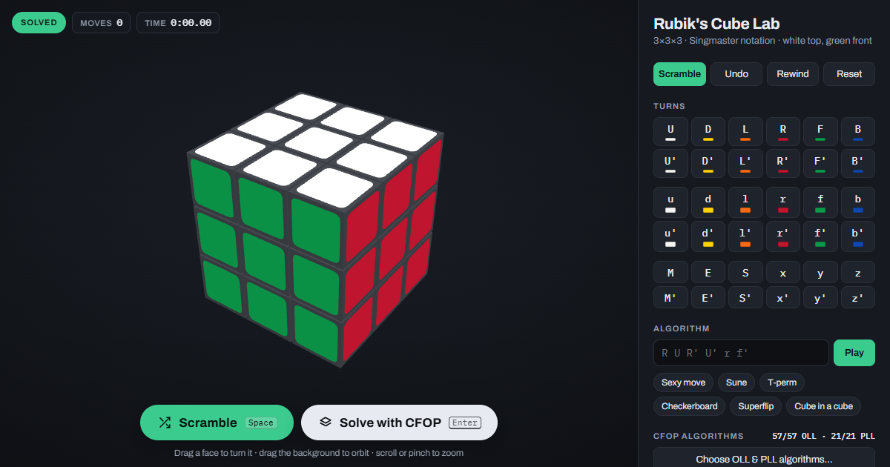

# Rubik's Cube Lab

An interactive 3D Rubik's cube that runs in the browser. Scramble it, turn it by hand or from the keyboard, and watch a step-by-step CFOP solution.

**Try it: https://michitruste.github.io/rubik/**



## Features

- **3D cube**: drag a face to turn it, drag the background to orbit, scroll or pinch to zoom.
- **Every move in Singmaster notation**: face turns, wide turns (`r u f…`), slices (`M E S`) and whole-cube rotations (`x y z`), plus a box to type and play any algorithm.
- **Random scrambles** (22 moves) that you can copy and go back to.
- **CFOP solver** that shows the cross, the four F2L pairs, OLL and PLL. Play it all at once or step by step, with a diagram for each step.
  - *Human-style* or *fewest moves* solutions, with any cross color.
  - Choose which OLL and PLL cases and algorithms it may use: the full 1-look set, the 2-look beginner set, or your own. Export your choices to a file and import them again.
- **Flat net** of all six faces, a move history, a move counter and a timer.
- Light and dark themes, and it works on phones.

## Keyboard

| Keys | Action |
| --- | --- |
| `U` `D` `L` `R` `F` `B` | Face turns (hold `Shift` for prime) |
| `W`, then a face | Wide turn |
| `M` `E` `S` | Slice turns |
| `X` `Y` `Z` | Whole-cube rotations |
| `Space` | Scramble |
| `Enter` | Solve with CFOP |
| `←` `→` | Step one solution move |
| `Backspace` | Undo |

## Running locally

Everything is in one file, `index.html`, and the only dependency is [three.js](https://threejs.org/), loaded from a CDN. Serve the folder with any static server:

```bash
python -m http.server 8765
```

Then open http://localhost:8765/.
